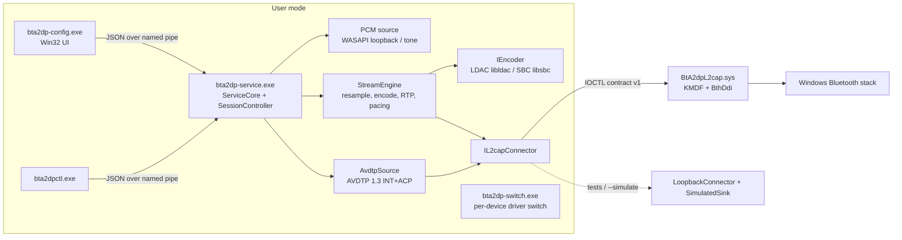

# BtA2dpSrc architecture

BtA2dpSrc is an independently implemented Windows 11 A2DP **source** that streams to Bluetooth headphones with **LDAC**, falling back to **SBC**. It shares no code with AltA2DP. The analysis in `reverse-engineering/` was used only as a technical reference.

## Why some kernel code is unavoidable

| Need | User-mode option? | Consequence |
|---|---|---|
| L2CAP channels to PSM 0x19 (AVDTP signalling + media) | **No.** Win32/WinRT expose RFCOMM and GATT only | A small KMDF profile driver (`BtA2dpL2cap.sys`) proxies L2CAP |
| Replace the in-box codec set | **No** codec extension point in `BthA2dp.sys` | The proxy is installed *per device*, replacing BthA2dp for that headset only |
| A virtual Windows playback device | **No** (needs a kernel audio driver) | Not implemented yet. The interim audio source is WASAPI loopback (below) |

Everything else runs in user mode, including AVDTP, codec negotiation, LDAC and SBC encoding, RTP packetisation, pacing, ABR, fallback, settings, and diagnostics.

## Components



| Module | Path | Responsibility |
|---|---|---|
| common | `src/common` | Status/Result, structured logging (ring buffer exposed over IPC), JSON, validated settings with atomic save |
| a2dp | `src/a2dp` | Codec information elements (SBC/LDAC), negotiation, AVDTP PDUs and fragmentation, AVDTP source session, RTP media packets, LDAC frame-header parsing |
| codec | `src/codec` | `IEncoder`; SBC (Google libsbc); LDAC (AOSP libldac + ABR); PCM conversion; windowed-sinc resampler |
| pipeline | `src/pipeline` | Lock-free SPSC PCM ring, sources, `StreamEngine` (MMCSS thread, high-resolution timer, send-ahead pacing, underrun silence, drift drop, transmit feedback for ABR) |
| core | `src/core` | `SessionController` actor: connect → discover → negotiate → configure → open → start; LDAC→SBC fallback; reconnect; live quality changes; confirmed-codec status |
| transport | `src/transport`, `src/platform/kernel_l2cap.*` | `IL2capChannel`/`IL2capConnector`; loopback implementation; kernel-driver implementation |
| sim | `src/sim` | AVDTP sink emulator that decodes SBC (libsbc) and walks LDAC frames, for tests and `--simulate` |
| platform | `src/platform` | Bluetooth discovery (bthprops, Winsock SDP, CfgMgr32), WASAPI loopback, named-pipe IPC, `ServiceCore` |
| apps | `src/service`, `src/ctl`, `src/config_app`, `src/installer` | Service, CLI, UI, driver switcher |
| driver | `src/driver/l2cap` | KMDF L2CAP proxy (**unbuilt here**, see DRIVER.md) |

## Session flow

```mermaid
sequenceDiagram
  participant C as SessionController
  participant A as AvdtpSource
  participant S as Sink
  C->>A: Connect (L2CAP PSM 0x19)
  A->>S: DISCOVER
  A->>S: GET_ALL_CAPABILITIES (fallback GET_CAPABILITIES)
  C->>C: choose LDAC if (pref allows) and sink offers it and encoder preflight ok; else SBC (+reason)
  A->>S: SET_CONFIGURATION (+Delay Reporting if offered)
  alt sink rejects LDAC
    A->>S: ABORT, then SET_CONFIGURATION SBC
  end
  A->>S: OPEN, then media L2CAP channel
  S-->>A: DELAYREPORT (optional)
  C->>C: encoder.Open(cfg, media MTU)
  A->>S: START
  loop StreamEngine
    C->>S: RTP media packets (LDAC/SBC frames)
  end
  Note over C: encoder failure on LDAC: SUSPEND, CLOSE, SET_CONFIGURATION SBC, OPEN, START
```

## Status truthfulness
- `activeCodec` and `codecConfirmed` are set only when three things all hold: the engine is running, it has sent at least one packet that the transport accepted, and the AVDTP stream is `streaming`.
- On suspend, error or disconnect, `codecConfirmed` becomes false.
- `fallbackReason` explains every case where SBC is used instead of LDAC.

## Audio source paths
1. **WASAPI loopback (implemented, verified on hardware):** captures the mix of a chosen playback endpoint and streams it to the headset. The user plays audio on any endpoint, typically a speaker that can be muted. Mix rate, format and channel count are handled (float32/16/24/32-bit; resampling to the negotiated rate).
2. **Virtual endpoint driver (not implemented):** a dedicated "BtA2dpSrc" playback device. See DRIVER.md for the evaluation and plan.
3. **Tone (implemented):** a 1 kHz test signal for diagnostics.

## Threading
- `SessionController` mutates state only on its actor thread. Public methods post work to it and never block.
- `AvdtpSource` has a receive thread. Requests are matched to responses by transaction label, and sink-initiated commands are answered inline.
- `StreamEngine` runs one MMCSS "Pro Audio" thread paced by a high-resolution waitable timer.
- Channel lifetime rule: media channels are closed (not destroyed) by protocol events. They are destroyed only after the engine stops, which fixes a use-after-free found by the reconnect test.
