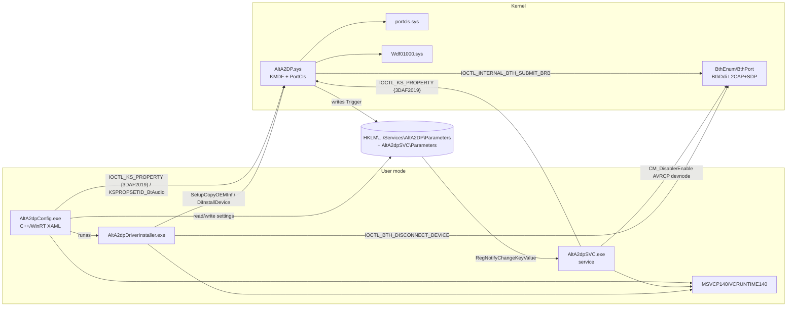

# 01 — Inventory: AltA2DP 1.8.3.1

**Target:** `E:\A2DP\AltA2DP` (read-only static analysis, 2026-10-14)
**Tools:** `dumpbin` 14.36 (headers, imports, disassembly), `signtool verify` (read-only), Python string/GUID/table scanners (stdlib only). Nothing in the target was installed, loaded, executed or modified.
**Evidence IDs** (`E-nn`) refer to [04-evidence.md](04-evidence.md).

## 1. File inventory

| Path | Size | Type / Subsystem | Build path (PDB) | Role (status) |
|---|---|---|---|---|
| `Driver/AltA2DP.sys` | 823,304 | PE32+ x64, Native, KMDF + PortCls | `C:\Products\AltA2DP\AltA2DP-1.8.3-d\DRV\Build\x64\Release\AltA2DP.pdb` | Kernel driver. Bluetooth A2DP **source** profile (AVDTP over L2CAP), codec encoders and the audio endpoint (**VERIFIED**, E-01, E-03, E-05, E-10) |
| `Driver/AltA2DP.inf` | 13,572 | INF (UTF-16) | — | Binds to `BTHENUM\{0000110b-…}`, MEDIA class (**VERIFIED**, E-01) |
| `Driver/AltA2DP.cat` | 11,934 | Catalog | — | Signed by Microsoft Windows Hardware Compatibility Publisher (**VERIFIED**, E-20) |
| `AltA2dpSVC.exe` | 74,520 | x64 console (Win32 service) | `…\Build\x64\RelWithDebInfo\AltA2dpSVC.pdb` | Helper service: restarts the AVRCP devnode when the driver asks (**VERIFIED**, E-12, E-13) |
| `AltA2dpConfig.exe` | 3,191,576 | x64 GUI, C++/WinRT + XAML Islands | `…\AltA2dpConfig.pdb` | Config UI, licensing, feedback/diagnostics, driver switching (**VERIFIED**, E-14…E-17) |
| `AltA2dpDriverInstaller.exe` | 129,816 | x64 console, C++/WinRT 2.0.220110.5 | `…\AltA2dpDriverInstaller.pdb` | Stages the INF and switches each device's driver (**VERIFIED**, E-18) |
| `resources.pri` | 126,056 | MRM PRI (`mrm_pri2`) | — | Localized UI strings: de-DE, en-US, ja-JP, ko-KR, pl-PL, … (**VERIFIED**) |
| `Docs/eula.html` | 1,611 | HTML | — | **Generic MIT template with placeholders.** It is dated 2026-10-14, unlike the other files (2026-06-18), and contradicts the binaries' "All rights reserved" notice. Treat it as **not the product licence** (E-21) |
| `MSVCP140*.dll`, `VCRUNTIME140*.dll` | — | MSVC 14.x runtime (2025-07-11) | — | App-local CRT for the user-mode EXEs. The driver does not use them |

**Referenced but missing:** `Docs\3rdparty.html`, `Docs\FAQ.html` (strings in `AltA2dpConfig.exe`, E-16). The third-party notices, which would settle codec provenance, are therefore unavailable.

**Version metadata (all binaries):** CompanyName "Luculent Systems, LLC", ProductName "Alternative A2DP Driver", Version 1.8.3.1, © 2022-2026. Link timestamps: 2026-06-19 00:36 (sys) and 01:41 (EXEs). The INF `DriverVer` is 06/18/2026,1.8.3.1.

## 2. Components and entry points

| Component | Entry point | Key imports (evidence of responsibility) |
|---|---|---|
| `AltA2DP.sys` | `DriverEntry` stub at RVA `0x11F20` (KMDF stub `FxDriverEntry`; strings `KmdfLibrary`, `FxStubBindClasses`) | **portcls**: `PcInitializeAdapterDriver`, `PcAddAdapterDevice`, `PcNewPort`, `PcRegisterSubdevice`, `PcRegisterPhysicalConnection`, `PcNewServiceGroup`, `PcRegisterAdapterPowerManagement`. **WDFLDR** (KMDF bind). **ntoskrnl**: `KeSave/RestoreExtendedProcessorState` (FP/SIMD in kernel), `PsCreateSystemThread`, `KeSetPriorityThread`, `ExAllocateTimer/ExSetTimer` (high-resolution timers), `KeQueryInterruptTimePrecise`, `IoRegisterDeviceInterface`, `Io{Get,Set}DeviceInterfacePropertyData`, `IoRegisterPlugPlayNotification`. **WppRecorder** (WPP/IFR tracing) |
| `AltA2dpSVC.exe` | `wmain` → `StartServiceCtrlDispatcherW` | `RegNotifyChangeKeyValue`, `CreateWaitableTimerW`, `DeviceIoControl`, `CM_Get_Device_Interface_ListW`, `CM_Get_DevNode_PropertyW`, `CM_Disable_DevNode`, `CM_Enable_DevNode` |
| `AltA2dpConfig.exe` | WinMain (XAML Islands `DesktopWindowXamlSource`) | Registry, `CM_Register_Notification`, `DeviceIoControl`, `CoCreateInstance`/`IKsControl`, WinRT `Windows.Devices.Bluetooth.*`, `Windows.Web.Http.HttpClient`, `Windows.Security.Cryptography.Core.*`, WMI (`root\cimv2`, `root\wmi`), `wlanapi`, ETW controller (`ControlTraceW`) |
| `AltA2dpDriverInstaller.exe` | `wmain` | `SetupCopyOEMInfW`, `newdev!DiInstallDevice`, `SetupDiBuildDriverInfoList/EnumDriverInfo`, `DeviceIoControl(0x41000C)`, WinRT `Windows.Devices.Radios.Radio` |

## 3. Installation and binding (from the INF, E-01)

- `[Manufacturer] … NTamd64.10.0...16299, NTamd64.10.0...22000`: **x64 only**, Windows 10 1709+ and Windows 11 sections. No ARM64.
- Hardware ID: `BTHENUM\{0000110b-0000-1000-8000-00805f9b34fb}`. This is the **remote device's A2DP AudioSink SDP service**, the same devnode the in-box `BthA2dp.sys` binds to. AltA2DP **replaces** BthA2dp per device; it is not a filter.
- Service `AltA2DP`: kernel driver, demand start, `%13%` (run from Driver Store), `PnpLockDown=1`. Parameters `LogPages=0x10`, `VerboseOn=1` (WPP IFR).
- Interfaces: `KSCATEGORY_AUDIO`+`KSCATEGORY_RENDER` for "Wave", and `KSCATEGORY_AUDIO`+`KSCATEGORY_TOPOLOGY` for "Topology". Proxy CLSID `{17cca71b-…}` (KS proxy).
- SysFX: uses **Microsoft's in-box APOs** ("Microsoft Audio Home Theater Effects"; Win10 uses `mssysfx.CopyFilesAndRegister`, Win11 uses `…CapX`). There is **no custom APO**.
- No `.Services` or INF registration for `AltA2dpSVC`. The service is created by the installer or Config (INFERRED; `AltA2dpSVC` name appears in Config, E-16).

## 4. Dependency graph

## 5. Supported platforms, codecs and options (verifiable portion)

| Item | Finding | Status |
|---|---|---|
| OS | Win10 1709+ and Win11 (INF decorations) | VERIFIED (E-01) |
| Arch | x64 only | VERIFIED (PE machine 0x8664; INF) |
| Codecs offered in the UI | SBC, AAC, LDAC, aptX, aptX HD, aptX LL (`cbiSbc…cbiAptxLl`) | VERIFIED (E-15) |
| Codecs parsed from sink capabilities | Same six, plus **aptX Adaptive** (`0xD7/0x00AD`), which is recognized but not offered | VERIFIED (E-06) |
| PCM formats exposed | 16-bit stereo at 8/11.025/12/16/22.05/24/32/44.1/48/64/88.2/96 kHz; 24-bit stereo at 44.1/48/88.2/96 kHz. No float | VERIFIED (E-09) |
| Settings | ~100 registry values per device (see 03 §6) | VERIFIED (E-11) |
| Licensing | Product licence plus a separate AAC licence/trial (`*.aalic`, trial fetched from a server) | VERIFIED as UI/strings; mechanism not analysed (out of scope) |

## 6. Unresolved questions (inventory level)

1. Who creates the `AltA2dpSVC` service, and with what start type? (Installer and Config disassembly not fully traced.)
2. Contents of the missing `Docs\3rdparty.html`, which would confirm codec library provenance and licences.
3. Meaning of `APXENUM\` and the `INTELAUDIO` strings in Config (possibly Intel SST/offload detection).
4. Why `Docs/eula.html` is a placeholder MIT template with a recent modification date.
