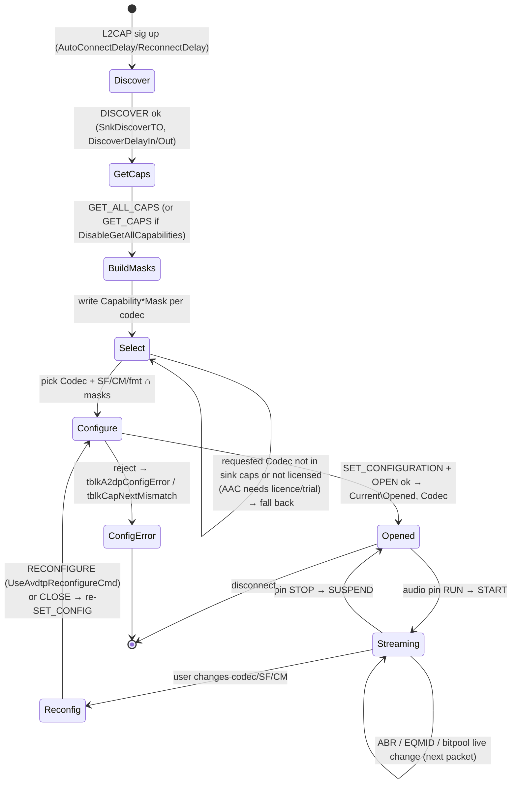

# 03 — LDAC Pipeline and Codec Negotiation

Throughout this document, **[BIN]** marks evidence from the target binaries and **[EXT]** marks public external references used only to interpret constants:
- **[EXT-1]** AOSP `platform/external/libldac` (`src/tables_ldac.c`, `inc/ldacBT.h`), Sony Corporation, Apache-2.0.
- **[EXT-2]** AOSP `packages/modules/Bluetooth/system/stack/include/a2dp_vendor_ldac_constants.h`.

No source code was recovered. Algorithms are **not** reconstructed from the binary.

## 1. Provenance of the LDAC encoder

| Claim | Evidence | Status |
|---|---|---|
| The driver contains Sony **libldac** (AOSP) tables | [BIN] `AltA2DP.sys` `.rdata`: `ga_smplrate_ldac` = {44100, 48000, 88200, 96000} as uint32 at file `0xB4C00` (VA `0x1400B5C00`); `ga_isp_ldac` (35 × uint16, 0…256) at file `0xB4CB0`; `ga_nqus_ldac` (17 × uint8, 0…34) at file `0xB4CF8`. **Byte-exact matches, in the same order and proximity as `tables_ldac.c` [EXT-1]** | **VERIFIED HIGH** |
| The encoder runs in **kernel mode**, inside `AltA2DP.sys` | Tables are in the `.sys`; no LDAC DLL exists; the service and Config have no encoder imports; `KeSaveExtendedProcessorState` is imported | **VERIFIED HIGH** |
| Float vs fixed-point build of libldac | Both variants exist upstream (`*_fixp_ldac.c`). Not distinguished | UNKNOWN |
| Version or modifications of libldac | Not determinable without symbols | UNKNOWN |
| Licence | libldac is Apache-2.0 [EXT-1]. The product's third-party notice file (`Docs\3rdparty.html`) is **missing** | INFERRED (licence of upstream); compliance UNKNOWN |

## 2. A2DP capability and configuration format

The codec info element follows [EXT-2]: LOSC = 10, vendor ID `0x0000012D` (Sony), codec ID `0x00AA`.

```
Media Codec service capability (AVDTP category 0x07)
 off  len  value
 0    1    0x07                Service Category = Media Codec
 1    1    0x0A                LOSC = 10
 2    1    0x00                Media Type = Audio (<<4)
 3    1    0xFF                Codec Type = Non-A2DP (vendor)
 4    4    2D 01 00 00         Vendor ID 0x0000012D (LE)
 8    2    AA 00               Codec ID 0x00AA (LE)
 10   1    SF mask             0x20 44.1 | 0x10 48 | 0x08 88.2 | 0x04 96 | 0x02 176.4 | 0x01 192
 11   1    CM mask             0x04 Mono | 0x02 Dual | 0x01 Stereo
```

[BIN] The driver builds exactly this in SET_CONFIGURATION:
- At `0x1400833AF`–`0x1400833BF`: `dword 0xFF000A07` then `dword 0x0000012D`, `word 0x00AA`, then `word [dev+0x84FA]`, which holds the selected SF/CM bytes.
- A second builder at `0x14009104B`–`0x14009107A` produces the same bytes.

**VERIFIED HIGH.**

The full SET_CONFIGURATION PDU, as reconstructed from stores at `0x1400833DA`…`0x140083400` and the length of `0x14`:

```
[hdr: TL<<4 | single | cmd]  0x03 (SET_CONFIGURATION)
[ACP SEID<<2] [INT SEID<<2 = 0x04]
01 00                                   Media Transport
07 0A 00 FF 2D 01 00 00 AA 00 SF CM     Media Codec (LDAC)
08 00                                   Delay Reporting   (conditional: test [dev+0x84DC] & 4)
```

- The transaction label is a global byte counter at `0x1400BE834`, incremented and shifted left by 4.
- Delay Reporting is added only when the flag bit (`[dev+0x84DC] & 4`) is set. Presumably that means the sink advertised it (INFERRED).
- Header field placement: VERIFIED. ACP/INT SEID semantics: INFERRED from the AVDTP specification.

**Capability parser** [BIN] `0x140087E40`–`0x1400887A7`. It requires category 7 and checks codec type and vendor/codec IDs with these length checks (category + LOSC + payload):

| Codec | Match | Length check | Status |
|---|---|---|---|
| SBC | type `0x00` | 8 | VERIFIED |
| AAC | type `0x02` | 10 | VERIFIED |
| vendor (generic) | type `0xFF` | ≥ 10 | VERIFIED |
| **LDAC** | `0x12D` / `0x00AA` | **12** | VERIFIED |
| aptX | `0x4F` / `0x0001` | 11 | VERIFIED (vendor; codec ID via register = 1, INFERRED) |
| aptX HD | `0xD7` / `0x0024` | 15 | VERIFIED |
| aptX Adaptive | `0xD7` / `0x00AD` | (separate path) | VERIFIED (recognized only) |
| aptX LL | `0x0A` / `0x0002` | 21 | VERIFIED (vendor); codec ID INFERRED (`r10d=2`) |

## 3. Encoder interface (expected API; call sites not individually identified)

libldac's public API [EXT-1] is:
- `ldacBT_get_handle`
- `ldacBT_init_handle_encode(h, mtu, eqmid, cm, fmt, sf)`
- `ldacBT_encode(h, pcm, &pcm_used, stream, &stream_sz, &frame_num)`
- `ldacBT_set_eqmid` / `ldacBT_alter_eqmid_priority`
- `ldacBT_get_bitrate`
- `ldacBT_close_handle` / `ldacBT_free_handle`

The binary has no exports or symbols, so **these call sites were not located**. Mapping the product's settings to the parameters:

| libldac parameter | Product setting [BIN strings] | Values exposed in UI [BIN `AltA2dpConfig.exe`, `resources.pri`] | Status |
|---|---|---|---|
| `sf` | `LdacSamplingFrequency`, `LdacSamplingFrequencyMask` | 44.1 / 48 / 88.2 / 96 kHz (`chLdacSf44k1…chLdacSf96k`) | VERIFIED (UI); mapping INFERRED |
| `cm` | `LdacChannelMode`, `LdacChannelModeMask` | Stereo, Dual Channel, Mono (`cbiLdacStereo`, `cbiLdacDualChannel`, `chLdacMono`) | VERIFIED / INFERRED |
| `fmt` | `LdacSampleFormat`, `LdacSampleFormatMask` | 16-bit / 24-bit (`chLdac16bit`, `chLdac24bit`); "Allow OS/app to choose bit resolution from" | VERIFIED / INFERRED (S16/S24) |
| `eqmid` | `LdacEqmid` | "Encode Quality": MQ (Low), SQ (Medium), HQ (High) (`rbLdacMQ/SQ/HQ`) | VERIFIED / INFERRED (HQ=0, SQ=1, MQ=2 per [EXT-1]) |
| ABR | `AbrEnable` plus `Abr*` thresholds (shared with SBC: `chSbcAbr`, `chLdacAbr`) | Checkbox and FAQ link | VERIFIED (option). Whether libldac's ABR or a **custom** ABR is used is UNKNOWN; the shared SBC/LDAC knobs suggest a custom controller (INFERRED MEDIUM) |
| `mtu` | Negotiated L2CAP MTU; `TxMaxSize` | — | INFERRED |

**Nominal bitrates [EXT-1]** (not measured): HQ 990/909 kbps, SQ 660/606 kbps, MQ 330/303 kbps (48/96 vs 44.1/88.2 kHz). Live bitrate is reported in `Current\Bitrate` and shown in `tblkLdacBitrate` (VERIFIED as a status field).

**PCM input** [BIN]: 16-bit data ranges at 44.1/48/88.2/96 kHz and 24-bit data ranges at the same four rates (E-09). libldac consumes 128 samples/channel per `ldacBT_encode` call [EXT-1].

## 4. Packetization, timing and error handling

| Aspect | Finding | Status |
|---|---|---|
| Media payload header | Interop requires RTP (12 B) plus a 1-byte LDAC header with the frame count in the low nibble (`A2DP_LDAC_HDR_NUM_MSK 0x0F`, [EXT-2]). **Not located in the binary** | INFERRED (protocol necessity) |
| Transport | L2CAP media channel; `BRB_L2CA_ACL_TRANSFER` (type `0x105`) prepared at `0x14008B0BE` on the TX path | VERIFIED HIGH |
| Pacing | Dedicated system thread at priority 22 (`0x14008E8EA`), high-resolution `ExSetTimer`, `TxPeriod`/`TxSendAhead` knobs | VERIFIED (mechanism); periods UNKNOWN |
| Buffer control | `TxBufferLow/High/CriticalThreshold`, `AbrBufferHighShortTermAction`, `AbrShortTerm*`/`AbrLongTerm*` thresholds, period and percentages | VERIFIED (names) |
| Congestion telemetry | `TxTimeStats`, `TxTimeMax`, `TxTime{High,Critical}{Duration,Count}`. UI warnings: "delayed Bluetooth packet transmission … higher bitrate than your setup can handle" and "unusually long delay … bug in the Bluetooth adapter" | VERIFIED |
| Flush timeout | `TxFlushTO`, `LlFlushTO` (stale packets are flushed rather than retransmitted) | INFERRED MEDIUM |
| Live changes | UI: "Bitrate can be changed at any time and takes effect when the next media packet is transmitted" (EQMID/bitpool hot-swap without AVDTP reconfiguration) | VERIFIED (claim in UI); mechanism UNKNOWN |
| Device quirks | Config ships regexes for Sony VID `0x054C` PIDs and a list of named headsets, plus warnings "This device is known to drop LDAC support under certain conditions" and "Although this device supports aptX Adaptive, it does not provide the required backward compatibility…". Which list drives which warning is UNKNOWN | VERIFIED (data) |
| SCO interaction | `ScoActive` status; FAQ `#microphone`. The stream is presumably suspended or degraded while HFP SCO is active | INFERRED |

## 5. Codec-selection state machine (INFERRED from settings, UI text and parser)



Fallback order, default codec and the exact licence gating are **UNKNOWN**. The UI strings show that AAC is disabled unless licensed ("AAC is disabled because your license does not include AAC CODEC support") and that codecs the sink supports only conditionally are greyed out.

## 6. Configuration map (registry value names, VERIFIED from strings in `AltA2DP.sys` and `AltA2dpConfig.exe`)

Location (INFERRED HIGH): `HKLM\SYSTEM\CurrentControlSet\Services\AltA2DP\Parameters\Devices\<BD_ADDR %016I64x>`. Masks under `Capability`, status under `Current`.

| Group | Values |
|---|---|
| Selection | `Codec` |
| LDAC | `LdacChannelMode`, `LdacSamplingFrequency`, `LdacSampleFormat`, `LdacEqmid`; caps: `LdacChannelModeMask`, `LdacSamplingFrequencyMask`, `LdacSampleFormatMask` |
| SBC | `SbcChannelMode`, `SbcSamplingFrequency`, `SbcAllocationMethod`, `SbcSubbands`, `SbcBlockLength`, `SbcMinimumBitpool`, `SbcMaximumBitpool`; caps masks |
| AAC | `AacChannelMode`, `AacSamplingFrequency`, `AacBitrateMode`, `AacBitrate`, `AacPeakBitrate`, `AacBandwidth`, `AacAfterBurner`, `AacMaxSize`; caps masks |
| aptX family | `Aptx{,Hd,Ll}ChannelMode`, `…SamplingFrequency`, `AptxHdSampleFormat`; caps masks |
| ABR | `AbrEnable`, `AbrShortTerm{High,Low}Threshold`, `AbrLongTerm{High,Low}Threshold`, `AbrLongTermPeriod`, `AbrLongTerm{High,Low}Pct`, `AbrBufferHighShortTermAction` |
| Transport | `TxPeriod`, `TxSendAhead`, `TxMaxSize`, `TxMaxDuration`, `TxFlushTO`, `TxLatency`, `TxBuffer{Critical,High,Low}Threshold`, `TxTime{High,Critical}{Duration,Count}`; LL: `LlFlushTO`, `LlLatency`, `LlMaxSize`, `LlTCL`, `LlICL`, `LlGWBL`, `LlBufferLevel` |
| AVDTP behaviour | `UseAvdtpReconfigureCmd`, `DisableGetAllCapabilities`, `DiscoverDelayOut`, `DiscoverDelayIn`, `SnkDiscoverTO`, `AutoConnectDelay`, `ReconnectDelay`, `AvctpConnectionCheck` |
| Endpoint | `DisableFormatChangeEvent`, `FormFactor`, `VolumeLevel`, `VolumeInitializeDelay` |
| Status (`Current`) | `Opened`, `Bitrate`, `ScoActive`, `Delay`, `Error`, `TxTimeStats`, `TxTimeMax` |
| Service-level | `Parameters\LogPages`, `VerboseOn` (INF); `AltA2dpSVC\Parameters\Trigger` |

**Data flow from user setting to encoder:**
1. Config writes the value under `Parameters\Devices\<addr>`. (INFERRED: Config imports `RegSetValueExW`/`RegCreateKeyExW` and holds the same name table.)
2. The driver reads the per-device settings (KMDF registry APIs are reached through the WDF function table, so the calls cannot be resolved by name).
3. Parameters that change only the bitrate apply on the next packet. Codec/SF/CM changes need reconfiguration (Config's `btnReconnect` → `KSPROPERTY_ONESHOT_RECONNECT`).

Status: INFERRED MEDIUM.

## 7. Licensing and third-party dependencies (findings only)

| Component | Evidence | Upstream licence (external knowledge) | Note |
|---|---|---|---|
| libldac | Tables (E-07) | Apache-2.0 (Sony) | Attribution file missing from the package |
| FDK-AAC | Strings "AAC Encoder", "SBR Encoder", "MPEG Transport", "FDK Tools", "MPEG Surround Encoder" (file `0x6C6F0`–`0x6C750`) and the AAC sampling-rate table (E-08) | Fraunhofer FDK AAC licence (copyright licence only, **no patent licence**) | Consistent with the product selling AAC as a separate paid upgrade/trial |
| aptX / aptX HD | Quantizer tables equal to the public aptX tables (file `0xB5720`, `0xB6750`) | Unknown implementation. The tables match those in FFmpeg/libopenaptx (LGPL) **and** in Qualcomm's reference | Provenance UNKNOWN; patent status needs legal review |
| SBC | Configuration options present; no table fingerprint found (the bluez `sbc_offset4/8` int8/int32 patterns are **absent**) | — | Implementation provenance UNKNOWN (possibly custom) |
| ChaCha/Salsa constant `expand 32-byte k` | File `0x96398` (VA `0x140097398`), no direct code reference | — | Probably licence-file decryption. **Not analysed (out of scope: licensing/DRM)** |

## 8. LDAC unknowns
1. Location of the `ldacBT_*` call sites and the exact MTU passed.
2. Float vs fixed-point libldac build, and any modifications.
3. Whether ABR is libldac's own ABR or a product-specific controller.
4. Frames per packet, RTP timestamp increment, and handling of the `F/S/L` fragmentation bits ([EXT-2] `HDR_F/S/L_MSK`).
5. Behaviour at 176.4/192 kHz: masks allow them, but the driver's data ranges stop at 96 kHz and libldac supports 44.1–96 kHz only.
6. Default EQMID and the auto-fallback rules on congestion.
