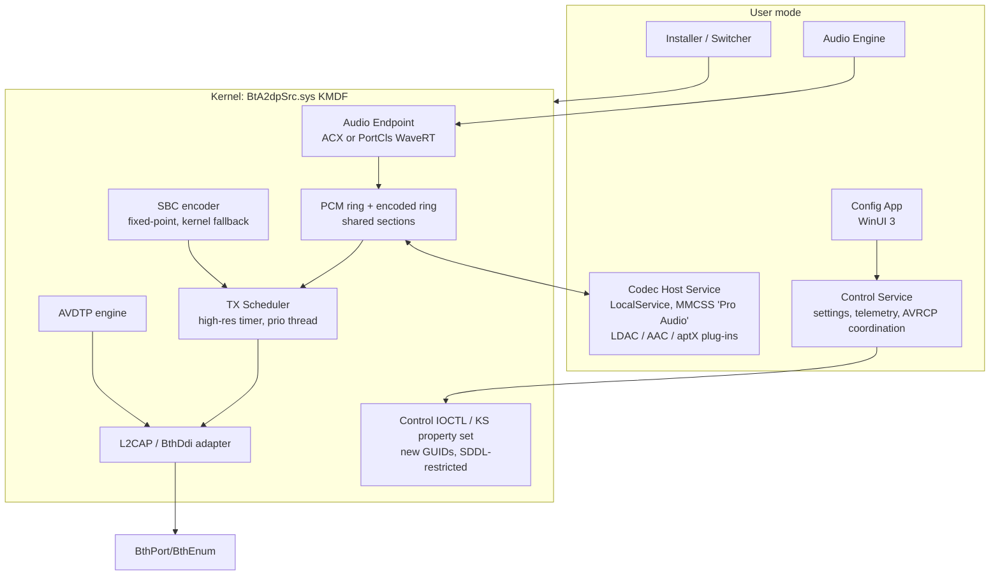

# 05 — Independent Rebuild Plan (Windows 11)

This document contains **recommendations for a new, independently implemented product**. Nothing here copies code, tables, GUIDs, resources or licence logic from AltA2DP. Codec libraries come from their own upstream sources under their own licences. All findings cited come from [02](02-architecture.md)–[04](04-evidence.md).

## 0. Constraints that shape the design

| # | Constraint | Basis | Consequence |
|---|---|---|---|
| C1 | Windows exposes **no public user-mode BR/EDR L2CAP API** (Win32/WinRT offer RFCOMM sockets and GATT only). AVDTP runs on L2CAP PSM 0x19 | Platform documentation; the original needed BthDdi in kernel (E-03, E-04) | The A2DP transport must be a **KMDF Bluetooth profile driver** using the documented BthDdi interface |
| C2 | Microsoft's `BthA2dp.sys` has **no supported codec-extension point** | Absence of documented API; the original replaces the driver (E-01) | The new driver must be the **function driver for `BTHENUM\{0000110B}`**, selected per device |
| C3 | An audio endpoint visible to the Windows audio engine requires a **kernel audio driver** (PortCls or ACX) | Windows audio driver model; original uses PortCls (E-09) | The endpoint also lives in kernel. The only open question is the model: ACX vs PortCls WaveRT |
| C4 | HVCI/Memory Integrity and Secure Boot are on by default on many Windows 11 PCs | Platform policy | Driver must be HVCI-compatible and attestation/WHQL-signed. Test signing is for lab machines only |
| C5 | HFP/SCO and AVRCP remain on Microsoft's stack (separate devnodes `0x111E`/`0x110E`) | Original does the same (E-13, E-01) | Must coexist with them and handle SCO preemption |

**Conclusion:** a kernel driver **is** necessary (C1–C3). The design choice that matters is **what else** goes into the kernel. The original put all codecs in kernel (E-07, E-08, E-10). This plan moves the optional codecs into user mode.

## 1. Target architecture



### Decision D1 — codec placement: **user-mode Codec Host, with kernel SBC as fallback** (recommended)

| Option | Pros | Cons |
|---|---|---|
| A. All codecs in kernel (original design) | Lowest latency; one process | Large third-party C code in ring 0 (FPU/SIMD save, stack limits, crash = BSOD); harder HVCI/HLK compliance; licence-sensitive code fused into the signed driver |
| **B. Optional codecs in a user-mode host; SBC in kernel** | Fault isolation: a crash falls back to SBC, no BSOD. Codecs can be swapped or updated without re-signing the driver. Can use OS-licensed Media Foundation AAC. Easier fuzzing and testing | Extra hop. Needs a shared-memory protocol and robust starvation handling |
| C. All codecs in user mode, including SBC | Smallest kernel | No audio at all if the service is down |

A2DP pipelines already buffer roughly 100–250 ms, and LDAC frames are 128 samples (2.7 ms at 48 kHz). A user-mode encode loop on an MMCSS thread with 20–40 ms of send-ahead should meet the budget. **M0 spike S3 must prove this** (§4). If it fails, fall back to Option A for LDAC only.

### Decision D2 — audio driver model
- **Preferred: ACX** (KMDF-based Audio Class eXtensions). It is a natural fit with a KMDF BthDdi driver, and it is Microsoft's forward direction on Windows 11. Confirm the minimum ACX version available on each supported Windows 11 build before committing (spike S2).
- **Fallback: PortCls WaveRT** using the SYSVAD virtual-endpoint pattern, which is documented and long-proven. Avoid WaveCyclic, the legacy model the original used.

### Decision D3 — driver selection
Bind with a hardware ID identical to the in-box driver (`BTHENUM\{0000110b-…}`), but **never auto-claim**. The switcher assigns the driver **per device** with documented SetupAPI/newdev APIs (`DiInstallDevice`, `UpdateDriverForPlugAndPlayDevicesW`) and records the previous driver so it can roll back.

## 2. Modules

Each entry gives responsibility, interfaces, dependencies, validation and risks.

### M-KM1 L2CAP/BthDdi Adapter (kernel)
- **Responsibility:**
  - Query `GUID_BTHDDI_PROFILE_DRIVER_INTERFACE`.
  - Open signalling and media channels (PSM 0x19) as initiator, and accept them as responder via `BRB_L2CA_REGISTER_SERVER`.
  - Configure MTU and flush timeout.
  - Submit `BRB_L2CA_ACL_TRANSFER` requests asynchronously with a bounded queue.
  - Handle disconnect indications.
- **Interface (internal):**

  ```
  L2capOpen(addr, psm, cfg) -> Channel
  L2capSend(ch, mdl, len, ctx)   async; completion carries status and timestamp
  L2capClose(ch)
  callbacks: OnRx(ch, buf), OnDisconnect(ch, reason)
  ```
- **Depends on:** WDK `bthddi.h`, KMDF I/O targets. Reference: the WDK `bthecho` sample, for *patterns* only.
- **Validation:** Driver Verifier (standard and IRQL), a fault-injection BRB-failure test, 10k connect/disconnect cycles without leaks.
- **Risks:** adapter-vendor quirks (Intel, Realtek, MediaTek, Barrot), flush-timeout support varies by adapter, BRB completion at DISPATCH_LEVEL.

### M-KM2 AVDTP Engine (kernel)
- **Responsibility:**
  - Implement the AVDTP 1.3 source role from the Bluetooth SIG specification: DISCOVER, GET_(ALL_)CAPABILITIES, SET_CONFIGURATION, GET_CONFIGURATION, RECONFIGURE, OPEN, START, SUSPEND, CLOSE, ABORT, DELAYREPORT.
  - Handle signal fragmentation, transaction labels and timeouts.
  - Handle sink-initiated procedures.
- **Data contract:**

  ```
  SEP_CAPS     { seid, inUse, mediaType, codecType, vendorId, codecId,
                 rawCaps[≤64], delayReporting }
  STREAM_CONFIG{ codec, sampleRate, channels/mode, bitDepth,
                 codecSpecific[≤16], mtu }
  ```
- **State machine:** IDLE → CONFIGURED → OPEN → STREAMING ↔ OPEN → CLOSING → IDLE, plus ABORTING from any state.
- **Validation:**
  - PTS (Bluetooth SIG Profile Tuning Suite) A2DP/AVDTP SRC test cases.
  - A **BlueZ-based sink testbed** on Linux that logs every PDU.
  - Fuzz the capability parser with malformed LOSC values (the original checks exact lengths; E-06).
- **Risks:** headset firmware deviations. The original exposes many toggles for these (`DisableGetAllCapabilities`, `UseAvdtpReconfigureCmd`, discover delays; E-11). Plan a quirk table from the start.

### M-KM3 Audio Endpoint (kernel)
- **Responsibility:**
  - Expose one render endpoint per connected sink.
  - Advertise data ranges equal to the *negotiated* configuration: PCM 16/24-bit, rates from codec caps. Prefer exposing only the negotiated rate to avoid resampling.
  - Provide jack and form-factor descriptions, volume/mute nodes and a position or presentation clock.
  - Surface the delay report to the audio engine.
- **Interface:** ACX circuit/stream callbacks, or the WaveRT miniport. The stream writes into the **PCM ring** (M-KM5).
- **Validation:** HLK audio tests; glitch tests (Windows Performance Recorder, audio glitch ETW); format-change handling while streaming. AV-sync check with video at 0 ms after delay compensation.
- **Risks:** endpoint re-creation on codec/rate change causes app interruptions. Implement a policy so a format change triggers endpoint invalidation (KSEVENT) only when unavoidable.

### M-KM4 TX Scheduler and Kernel SBC (kernel)
- **Responsibility:**
  - Drive packet cadence on a high-resolution timer and a dedicated thread (real-time priority, not passive polling).
  - Packetize: RTP header plus codec payload header.
  - Run send-ahead, buffer-level and flush-timeout policy.
  - Pull frames from the encoded ring, or encode SBC locally when the Codec Host is absent or late.
- **SBC:** independent fixed-point implementation written from the A2DP specification (no FPU in kernel), or a permissively licensed implementation after licence review.
- **Data contract:**

  ```
  TX_STATS { packetsSent, bytes, sendLatencyP50/P99, flushes,
             underruns, queueDepth }   exported through Control
  ```
- **Validation:** 24 h soak at max bitrate; under-run injection must switch to SBC in ≤ 1 packet period with no audible gap beyond 1 frame.
- **Risks:** timer coalescing and power states. Use `ExAllocateTimer` high-resolution only while streaming.

### M-KM5 Shared-Memory Codec Bridge (kernel ↔ Codec Host)
- **Responsibility:** two lock-free single-producer/single-consumer rings per stream, PCM out and encoded frames in, mapped into the Codec Host by an authenticated IOCTL. Also carries an event pair or IoRing-style notification.
- **Data contract (versioned):**

  ```
  RING_HEADER { magic, version, sizeBytes, writeIdx, readIdx,
                sampleRate, channels, bitDepth, framesPerPacketHint,
                seqNo, qpcTimestamp }
  ENC_FRAME   { pcmFramePos, rtpTimestamp, nFrames, flags(F/S/L), len, payload[] }
  ```
- **Security:**
  - The device interface SDDL grants access only to the Codec Host's service SID and SYSTEM.
  - Every header field from user mode is treated as untrusted: indices masked and lengths bounded.
- **Validation:** fuzz the IOCTL and ring fields; kill the Codec Host mid-stream; inject malicious writers.

### M-UM1 Codec Host Service (user)
- **Responsibility:** load codec plug-ins behind a common interface, run the encode loop on an MMCSS "Pro Audio" thread, and apply adaptive bitrate (ABR).
- **Plug-in interface:**

  ```
  ICodec::Capabilities() -> {vendorId, codecId, caps bytes}
  ICodec::Negotiate(sinkCaps, prefs) -> config bytes
  ICodec::Open(config, pcmFmt, mtu)
  ICodec::Encode(pcm, n) -> frames
  ICodec::SetQuality(level)          // live, takes effect next packet
  ICodec::Close()
  ```
- **LDAC plug-in:** AOSP `external/libldac` (Apache-2.0), unmodified, keeping the NOTICE. Parameters follow `ldacBT_init_handle_encode(mtu, eqmid, cm, fmt, sf)` with EQMID HQ/SQ/MQ plus ABR (03 §3). Packetization: 1-byte LDAC media header with frame count, and F/S/L fragmentation bits per AOSP constants.
- **AAC plug-in:** prefer the **Windows Media Foundation AAC encoder**, which ships with Windows and is OS-licensed (legal must confirm the terms cover this use). Wrap its output in MPEG-4 LATM/LOAS as A2DP requires. Alternative: FDK-AAC with a separate AAC patent licence.
- **aptX / aptX HD:** deferred. Use only an implementation with a clear licence and patent position. Exclude aptX LL and aptX Adaptive.
- **ABR:** an independent controller fed by TX_STATS (queue depth, send latency P99, flushes). Hysteresis via short- and long-term windows. Steps EQMID HQ→SQ→MQ for LDAC and bitpool for SBC.
- **Validation:** encode-loop timing under CPU stress (P99 encode time < 25 % of packet period); bit-exactness of the LDAC library build against AOSP test vectors where available.
- **Risks:** see §5.

### M-UM2 Control Service, settings and diagnostics (user)
- **Responsibility:**
  - Own the per-device settings store and push changes to the driver through a **new** control KS property set or IOCTL (own GUIDs). Use explicit SET requests, not registry polling.
  - Publish status: active codec, bitrate, delay, errors, TX stats.
  - Coordinate with AVRCP if testing shows absolute volume needs re-binding (the original restarts the AVRCP devnode; E-13). Treat that as a last-resort, opt-in workaround.
- **Settings schema** (`HKLM\SOFTWARE\<Vendor>\<Product>\Devices\<BD_ADDR>`, ACL: Administrators/SYSTEM write, Users read):
  - `PreferredCodec`, `CodecPrefs\<codec>\{SampleRates, ChannelMode, BitDepth, Quality, AbrEnabled}`, `Transport\{SendAheadMs, FlushTimeoutMs, MaxPacketBytes}`, `Quirks\…`
  - A versioned `SchemaVersion` value.
- **Diagnostics:**
  - ETW/TraceLogging provider in every component, plus a WPP-recorder IFR in the driver.
  - "Collect logs" bundles ETW traces and settings **locally**. Any upload is an explicit user action with a preview.
- **Validation:** settings round-trip tests; live quality change applied within one packet; telemetry overhead < 1 % CPU.

### M-UM3 Config App (user)
- WinUI 3 (or WPF) desktop app: device list, current codec and live bitrate, per-codec options limited to sink capabilities, quality presets, "safe defaults", reconnect (documented `KSPROPERTY_ONESHOT_RECONNECT`), and a driver toggle per device that calls the Switcher.
- **Validation:** accessibility (Narrator, keyboard), high-DPI, localization pipeline.

### M-UM4 Installer, Switcher and Rollback (user, elevated)
- **Responsibility:**
  - Stage the package (`pnputil /add-driver` or `DiInstallDriver`).
  - Switch a device to the new driver or back to the in-box A2DP driver (`DiInstallDevice` with an explicit driver node).
  - Force reconnect: documented `IOCTL_BTH_DISCONNECT_DEVICE`, or user-prompted radio toggle.
  - Install and uninstall services.
  - Clean uninstall restores every device to the in-box driver *before* removing the package.
- **Packaging:** MSIX for the apps with a Win32 elevated helper, or WiX MSI. Driver via a DCH-compliant INF: `PnpLockDown`, `%13%`, no co-installers.
- **Validation:** install/upgrade/uninstall matrix across 23H2/24H2/25H2; power loss mid-switch (a journal plus a recovery-on-boot task); WU driver-update interaction.

## 3. Signing, compliance and security

- **Signing:** EV code-signing certificate, then Partner Center **attestation signing** for Windows 11 client (the original took the same route; E-20). Consider WHQL/HLK for broader OEM distribution. Development uses test-signed lab machines only. Never ship instructions to disable Secure Boot or enable test signing.
- **HVCI:** compile with `/INTEGRITYCHECK`, use NX pool only (`POOL_FLAG_NON_PAGED`), no RWX, no dynamic code. Run Driver Verifier, Static Driver Verifier/CodeQL WHCP rules, and the HLK DF fuzz tests.
- **Attack surface:**
  - All IOCTL/KS handlers validate sizes and copy in/out.
  - Device-interface SDDL is restricted; SET operations require Administrators or the service SID.
  - Kernel parsing of remote AVDTP PDUs is the largest attack surface: fuzz it with a malicious BlueZ sink.
- **Privacy:** no device-data upload by default. Diagnostics are opt-in.

## 4. Implementation sequence and acceptance criteria

| Milestone | Scope | Acceptance criteria |
|---|---|---|
| **M0 — Spikes** (go/no-go) | **S1:** KMDF profile driver on `BTHENUM\{110B}` opens PSM 0x19 and logs DISCOVER/GET_ALL_CAPS from 5 headsets. **S2:** ACX (and a WaveRT fallback) virtual render endpoint, glitch-free into a null sink. **S3:** Codec Host round trip with libldac: kernel PCM ring → user encode → kernel encoded ring | S1 caps logged correctly for all 5 sinks. S2: 1 h with zero glitches in ETW. S3: P99 added latency ≤ 10 ms and 0 under-runs over 1 h at 990 kbps under 80 % CPU load. **If S3 fails, choose D1-A for LDAC** |
| **M1 — SBC end-to-end** | M-KM1–4, kernel SBC, full AVDTP SRC, delay reporting, basic switcher | Plays to 10 reference sinks. Reconnect after sleep/resume and radio toggle. PTS A2DP-SRC mandatory cases pass. Verifier clean for 24 h |
| **M2 — LDAC** | M-KM5, M-UM1 with LDAC, live EQMID change, fallback to SBC on host loss | Negotiates 44.1/48/88.2/96 kHz, 16/24-bit, on ≥ 5 LDAC sinks. Reported bitrate within ±5 % of nominal. Killing the host → SBC within 1 packet period, then automatic restore |
| **M3 — Control, ABR, diagnostics** | M-UM2, M-UM3, ABR controller, ETW | ABR steps down within 2 s of injected congestion and recovers with hysteresis. UI reflects state in < 500 ms |
| **M4 — AAC (and optionally aptX/HD)** | Plug-ins after legal sign-off | AAC (LATM) interop with ≥ 5 AAC sinks, including AirPods-class devices |
| **M5 — Release engineering** | Installer, rollback, signing, HLK, docs, NOTICE file | Clean install, upgrade and uninstall on 3 OS builds. Rollback restores the in-box driver on every device. Attestation-signed package loads with HVCI on |

## 5. Risk register

| Risk | Type | Likelihood / Impact | Mitigation |
|---|---|---|---|
| User-mode encode jitter causes dropouts | Technical | M / H | S3 gate; MMCSS; send-ahead; kernel SBC fallback; LDAC-in-kernel fallback (D1-A) |
| Headset AVDTP quirks | Interop | H / M | Quirk table keyed by OUI/name/VID-PID, discovered by a test lab; per-device overrides |
| Adapter quirks (flush timeout, ACL scheduling, Barrot/MTK issues) | Interop | H / M | Adapter matrix; telemetry of send latency; documented limitations |
| HFP/SCO preemption, mic use | Interop | H / M | Detect SCO and suspend A2DP cleanly; resume on SCO end; document that the mic uses Microsoft HFP |
| AVRCP / absolute volume desync after driver swap | Interop | M / M | Investigate the Microsoft AVRCP interaction; opt-in AVRCP devnode restart as a last resort |
| LDAC licensing / trademark | Legal | M / H | Apache-2.0 libldac unmodified, NOTICE retained; counsel to review the Apache patent grant scope and "LDAC" trademark use |
| AAC patents | Legal | H / H | Media Foundation encoder (confirm OS licence scope) or a Via LA licence; otherwise ship without AAC |
| aptX patents / source | Legal | H / M | Defer; ship only with a clear licence |
| Bluetooth SIG qualification and trademark | Legal | M / M | Determine whether a qualification listing is needed for a software profile product; avoid the BT logo until then |
| Driver signing or HLK failures | Compliance | M / H | Early HLK dry runs; Verifier/CodeQL in CI |
| Windows update replaces the driver with the in-box one | Ops | M / M | Switcher detects and restores per user preference; documented |
| Kernel parsing of remote PDUs (security) | Security | M / H | Strict length checks, fuzzing, no recursion, bounded buffers |

## 6. Test strategy

- **Lab matrix:** ≥ 15 sinks (Sony LDAC models, AAC-only, aptX, SBC-only budget), ≥ 6 adapters (Intel AX2xx/BE2xx, Realtek, MediaTek, Qualcomm, Barrot USB), Windows 11 23H2/24H2/25H2, and **HVCI on**.
- **Latency:** acoustic loopback (reference click → headset → measurement mic) compared with the reported AVDTP delay. Accept |measured − reported| ≤ 20 ms.
- **Quality:** objective metrics (ViSQOL/PEAQ) where the sink's analog output can be captured; bitrate and packet-loss telemetry; blind A/B listening against the Microsoft driver's SBC/AAC.
- **CPU and power:** encode CPU per codec at each quality; package C-state residency while idle (no timers when not streaming).
- **Stability:** 24/72 h soak with Driver Verifier; sleep/resume ×500; connect/disconnect ×10k; codec switch ×1k; Codec Host crash ×100.
- **Conformance:** PTS A2DP/AVDTP SRC; HLK audio and Bluetooth suites.

## 7. Recommended next steps (before any implementation)

1. **Legal review:** LDAC (Apache-2.0 scope and trademark), AAC route, aptX, Bluetooth SIG qualification.
2. Approve decisions **D1–D3**, or amend them.
3. Build the **M0 spikes** S1–S3 with the go/no-go gates above.
4. *(Optional further RE, read-only)* Map KMDF `WdfFunctions[]` indices in `AltA2DP.sys` to resolve registry and I/O-target calls. This would help answer open items in 04 §Unknowns, for interoperability insight only, never for code reuse.
5. Assemble the device and adapter test lab and the BlueZ PDU-logging sink.
